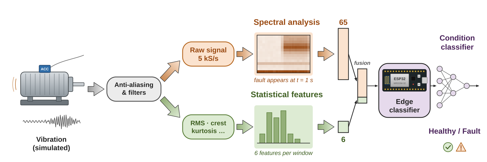
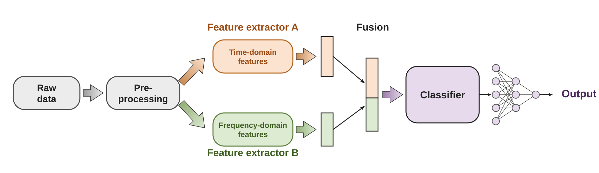

# Diagramas/Figuras

**Figuras y diagramas de nivel publicación, generados con código.**

`paperfig` es una pequeña caja de herramientas en Python para producir:

- **Diagramas de metodología** (pipelines, arquitecturas, protocolos) como **SVG editable en Inkscape**:
  capas, texto real, un color pastel por ruta, flechas con degradado, vectores de características,
  redes neuronales e íconos vectoriales dibujados a mano.
- **Gráficas de datos** con **matplotlib** en un estilo de publicación consistente (paleta, ejes limpios,
  etiquetas de panel, exportación a PNG/PDF/SVG).

Cada figura puede salir en **dos versiones**: para **paper** (180 mm, doble columna) y para
**presentación** (16:9, lista para PowerPoint/Keynote/Google Slides).



## Instalación

```bash
git clone https://github.com/TU_USUARIO/paperfig.git
cd paperfig
pip install -e .
# Exportar a PNG/PDF requiere rsvg-convert:
#   Linux: sudo apt install librsvg2-bin    macOS: brew install librsvg
```

## Inicio rápido

```python
from paperfig.svg import SvgDoc, S1, S3, SN, SC, export

d = SvgDoc()
d.rbox(40, 230, 200, 100, SN);  d.text(140, 290, "Raw data", 28, "bold")
d.block_arrow(250, 280, 310, 280, SN)
d.rbox(320, 230, 220, 100, S1); d.text(430, 290, "Model", 28, "bold", S1["t"])
d.write("mi_figura.svg", 1800, 520, "180mm", "52mm")
export("mi_figura.svg")          # -> mi_figura.png y mi_figura.pdf
```

Ejemplo completo: [`examples/quickstart/pipeline.py`](examples/quickstart/pipeline.py)



## Módulos

| Módulo | Contenido |
|---|---|
| `paperfig.svg` | `SvgDoc` (texto, cajas redondeadas, flechas con degradado, líneas, vectores, redes MLP, capas de Inkscape), paleta por rutas `S1`–`S4`, `SN` (neutro), `SC` (modelo/salida), `export()` |
| `paperfig.icons` | Íconos vectoriales: motor con acelerómetro, mano, chip DIP-8, placa tipo ESP32, espectrograma, barras, trazo de señal |
| `paperfig.plotstyle` | `apply_publication_style()`, `PALETTE`, `panel_labels()`, `finalize_figure()` |
| `paperfig.signals` | Señales de ejemplo (`simulate_vibration()`), `stft_matrix()`, `band_levels()`, `stat_features()` |

## Ejemplos

| Ejemplo | Qué muestra |
|---|---|
| [`quickstart/`](examples/quickstart) | Pipeline genérico con dos ramas que se fusionan |
| [`vibration_monitoring/`](examples/vibration_monitoring) | Monitoreo de condición de un motor: dos ramas (espectral y estadística), fusión y clasificador embebido. Versión paper + diapositiva 16:9. El espectrograma y los rasgos se **calculan** de una vibración simulada |
| [`signal_plots/`](examples/signal_plots) | Gráfica de 3 paneles: señal limpia vs. ruidosa, señal con ráfagas + envolvente RMS, espectro FFT. Acepta tu propio CSV |

Generar todo: `make` (o `make quickstart`, `make vibration`, `make plots`).

## Guía de estilo (resumen)

- Un color pastel por ruta/modalidad, el mismo en toda la figura; títulos de bloque en negrita del color de su ruta.
- Paper: 180 mm de ancho, letras de panel **a, b, c**, texto ≥ 6 pt impreso; exportar SVG + PDF + PNG.
- Presentación: 1920×1080 (16:9), un panel por diapositiva, título arriba, texto ≥ 26 px, PNG a 3840×2160.
- Las gráficas dentro de un diagrama (espectrogramas, bandas, formas de onda) se calculan con datos reales
  o con una señal simulada realista, y se rotulan como *simulated* si no son datos reales.
- Revisar siempre el render: nada de textos encimados ni flechas cruzando etiquetas.

## Licencia

© 2026 Jesús Betancourt Martínez (ESIME Culhuacán, SEPI, IPN).

Todo el contenido (código y figuras) se distribuye bajo
**[Creative Commons Atribución-NoComercial 4.0 Internacional (CC BY-NC 4.0)](https://creativecommons.org/licenses/by-nc/4.0/deed.es)**:

- ✅ Puedes usar, copiar, modificar y adaptar el código y las figuras, incluso en artículos, tesis,
  presentaciones y material docente.
- ✅ Debes dar crédito al autor y enlazar a este repositorio.
- ❌ No puedes venderlos ni usarlos con fines comerciales.

Para usos comerciales, contactar al autor.

Cita sugerida:

> Betancourt Martínez, J. (2026). *paperfig: publication-quality figures and diagrams* [Software]. GitHub.

Todos los íconos están dibujados a mano en `src/paperfig/icons.py`; no se incluyen gráficos de terceros.
El estilo de las gráficas sigue las convenciones descritas en
[figures4papers](https://github.com/ChenLiu-1996/figures4papers) (Chen Liu); la implementación es propia.
